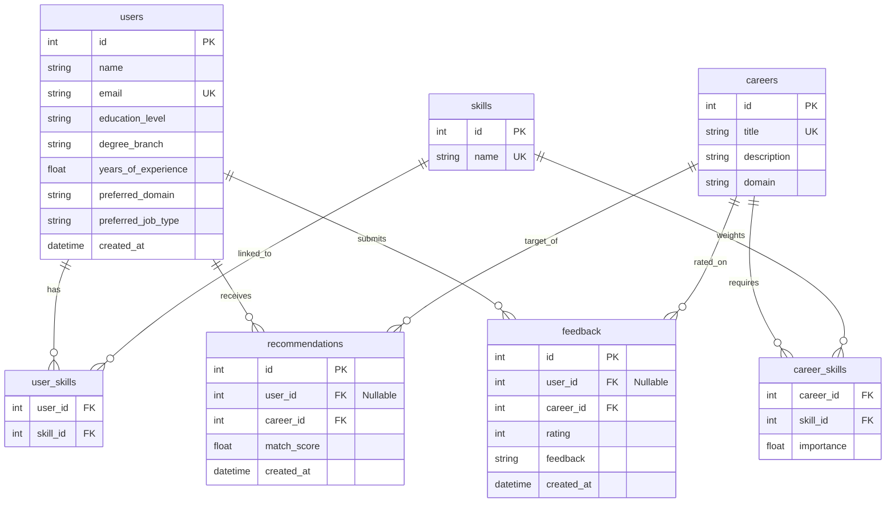

# CareerAI - AI Career Recommendation System

An enterprise-grade, production-ready AI-powered career recommendation platform. The system leverages machine learning classifiers to analyze user profiles—including technical skills, soft skills, educational backgrounds, years of experience, and interests—and suggests the top 3-5 most aligned career roles with custom fit scores, comprehensive skill gap analyses, and learning roadmaps.

---
## Project Overview

In the rapidly evolving tech space, finding the right career fit can be challenging. This platform provides data-driven career matches by utilizing supervised classification models trained on detailed developer profiles, combined with a deterministic rules-based skill parser.

When a user submits their profile, the ML model calculates the probability scores for various roles. The system then queries the database for career requirements, compares user skills against them, identifies the exact technical and soft skill gaps, and suggests tailored learning paths for career progression.

---

## Features

- **Multi-Model ML Engine**: Compares Logistic Regression, Random Forest, Decision Tree, and K-Nearest Neighbors to automatically serialize and deploy the best classifier.
- **Explainable Predictions**: Explains *why* a career is recommended using intersection analysis between user skills and career requirements.
- **Skill Gap Analysis**: Identifies exact missing skills sorted by importance for the target role.
- **Actionable Roadmaps**: Dynamically suggests specific study areas and resources for missing skills.
- **FastAPI Core**: Highly performant backend with automatic OpenAPI docs (Swagger), Pydantic schemas, dependency injection, and centralized error handling.
- **SQLAlchemy Database Layer**: Fully normalized tables with automatic seeding of careers and required skills on startup.
- **Docker Support**: Containerized using multi-stage builds.
- **Robust Integration Testing**: Unit and API test coverage via pytest using SQLite in-memory databases.

---

## Tech Stack

- **Language**: Python 3.12
- **Backend Framework**: FastAPI (Uvicorn server)
- **Data Engineering**: Pandas, NumPy
- **Machine Learning**: Scikit-learn, Joblib
- **Database**: PostgreSQL (Production) / SQLite (Fallback for testing and local dev)
- **ORM**: SQLAlchemy 2.0
- **Validation**: Pydantic v2
- **Testing**: Pytest, HTTPX

---

## Architecture & Folder Structure

The project follows a clean, modular layout separating ML pipelines, API endpoints, database operations, and configuration:

```text
ai-career-recommendation/
│
├── app/
│   ├── main.py                    # Application startup, middleware, and setup
│   ├── config.py                  # Pydantic environment configuration
│   │
│   ├── api/
│   │   └── routes/
│   │       ├── recommendation.py  # Recommendations & health checks
│   │       ├── users.py           # User management
│   │       ├── careers.py         # Careers listing and detail lookup
│   │       └── feedback.py        # Recommendation rating feedback
│   │
│   ├── models/                    # SQLAlchemy ORM Tables
│   │   ├── user.py
│   │   ├── career.py
│   │   ├── skill.py
│   │   └── recommendation.py
│   │
│   ├── schemas/                   # Pydantic Data validation & serialization
│   │   ├── user.py
│   │   ├── recommendation.py
│   │   └── career.py
│   │
│   ├── services/
│   │   └── recommendation_service.py # Recommendation & Gap Analysis logic
│   │
│   ├── ml/                        # Machine Learning Pipeline
│   │   ├── preprocess.py          # Data cleaning & ColumnTransformer pipeline
│   │   ├── train.py               # Model comparison & training execution
│   │   ├── evaluate.py            # Classification reports & metrics calculations
│   │   └── predict.py             # Inference/prediction runtime
│   │
│   └── database/
│       ├── connection.py          # SQLAlchemy Session & fallback setups
│       └── crud.py                # CRUD logic & DB Seeding script
│
├── data/
│   ├── career_dataset.csv         # Raw generated synthetic training data
│   └── processed_data.csv         # Preprocessed dataframe generated on train
│
├── models/
│   └── career_model.joblib        # Serialized best Scikit-learn Pipeline
│
├── notebooks/
│   └── exploratory_analysis.ipynb # Jupyter notebook for EDA
│
├── scripts/
│   └── generate_dataset.py        # Data generator tool
│
├── tests/
│   ├── test_recommendation.py     # Unit tests for preprocessing & services
│   └── test_api.py                # FastAPI integration tests
│
├── requirements.txt
├── .env.example
├── .env
├── .gitignore
├── README.md
└── Dockerfile
```

---

## ML Training & Preprocessing Pipeline

### 1. Data Cleaning
The system fills missing values (`fillna("Missing")` for categorical and `""` for text), parses numerical fields, and strips whitespaces.

### 2. Feature Engineering
- **Numerical Processing**: `years_of_experience` is scaled via `StandardScaler`.
- **Categorical Processing**: `education_level`, `degree_branch`, `preferred_domain`, and `preferred_job_type` are encoded via `OneHotEncoder(handle_unknown='ignore')`.
- **Text Processing**: Multiple text fields (`technical_skills`, `programming_languages`, `soft_skills`, `interests`, `career_interests`) are merged per profile and vectorized using a unified `TfidfVectorizer`.

### 3. Model Comparison & Serialization
`app/ml/train.py` splits the cleaned dataset into 80/20 train/test folds, runs four distinct classifiers, and selects the one with the highest macro F1-score. The entire `Pipeline` (including transformers and classifier) is serialized using `joblib` so that inference remains completely clean of data leakage.

---

## Database Schema



---

## API Endpoints

| Method | Endpoint | Description |
| :--- | :--- | :--- |
| **POST** | `/api/v1/recommend` | Submits profile, runs ML inference, returns ranked recommendations with gap analysis. |
| **POST** | `/api/v1/users/` | Creates a new user profile with associated skills in DB. |
| **GET** | `/api/v1/users/{user_id}` | Retrieves user profile details. |
| **GET** | `/api/v1/careers/` | Returns list of all seeded career roles. |
| **GET** | `/api/v1/careers/{career_id}` | Returns specific career details and required skills. |
| **POST** | `/api/v1/feedback/` | Stores user feedback (rating 1-5 and comment) for a recommendation. |
| **GET** | `/api/v1/health` | Check backend server & database connectivity status. |

---

## Installation & Setup

### Prerequisites
- Python 3.12+
- Git

### 1. Clone the Repository
```bash
git clone <repository_url>
cd ai-career-recommendation
```

### 2. Set Up Virtual Environment & Dependencies
```bash
# Create virtual environment
python -m venv venv

# Activate virtual environment (Windows)
.\venv\Scripts\activate

# Activate virtual environment (macOS/Linux)
source venv/bin/activate

# Install requirements
pip install -r requirements.txt
```

### 3. Environment Variables
Copy `.env.example` to `.env`:
```bash
cp .env.example .env
```
Default SQLite configuration is preconfigured. If you want to use PostgreSQL, uncomment and modify the `DATABASE_URL` line in `.env`.

---

## Running the Application

### Step 1: Generate the Training Dataset
Run the data generator script to create the synthetic training data:
```bash
python scripts/generate_dataset.py
```
This generates `data/career_dataset.csv`.

### Step 2: Train and Save the ML Model
Run the ML training script. It compares models and outputs the best serialized model:
```bash
python -m app.ml.train
```
This prints the evaluation reports for all algorithms and saves the best pipeline to `models/career_model.joblib`.

### Step 3: Run the FastAPI Server
Start the server locally:
```bash
uvicorn app.main:app --reload
```
The server will start at `http://127.0.0.1:8000`. 
Open `http://127.0.0.1:8000/docs` in your browser to view the interactive Swagger documentation.

---

## Example API Request & Response

### POST `/api/v1/recommend`

#### Request Body
```json
{
  "education_level": "Bachelor's",
  "degree_branch": "Computer Science",
  "technical_skills": [
    "Python",
    "Pandas",
    "Scikit-learn"
  ],
  "programming_languages": [
    "Python",
    "SQL"
  ],
  "soft_skills": [
    "Problem-solving",
    "Communication"
  ],
  "interests": [
    "Data Analysis",
    "Machine Learning"
  ],
  "years_of_experience": 2,
  "preferred_domain": "Data Science",
  "preferred_job_type": "Full-time",
  "career_interests": [
    "AI & Big Data"
  ]
}
```

#### Response Body
```json
{
  "recommendations": [
    {
      "career": "Data Scientist",
      "match_score": 93.4,
      "existing_skills": [
        "Python",
        "SQL",
        "Pandas",
        "Scikit-learn",
        "Problem-solving",
        "Communication"
      ],
      "missing_skills": [
        "Machine Learning",
        "Statistics",
        "Tableau",
        "NumPy"
      ],
      "reason": "Recommended because your skills in Python, SQL, Pandas show a strong alignment with the core requirements of a Data Scientist. Additionally, this aligns with your preferred domain of Data Science.",
      "suggested_learning_areas": [
        "Study Machine Learning theory and build projects using Machine Learning",
        "Improve your proficiency in Statistics via certification/courses",
        "Improve your proficiency in Tableau via certification/courses"
      ]
    },
    {
      "career": "Machine Learning Engineer",
      "match_score": 85.2,
      "existing_skills": [
        "Python",
        "Scikit-learn",
        "Problem-solving"
      ],
      "missing_skills": [
        "TensorFlow",
        "PyTorch",
        "Deep Learning",
        "MLOps",
        "Docker",
        "Git",
        "Kubernetes",
        "C++"
      ],
      "reason": "Recommended because your skills in Python, Scikit-learn, Problem-solving show a strong alignment with the core requirements of a Machine Learning Engineer.",
      "suggested_learning_areas": [
        "Study Machine Learning theory and build projects using TensorFlow",
        "Study Machine Learning theory and build projects using PyTorch",
        "Study Machine Learning theory and build projects using Deep Learning"
      ]
    }
  ]
}
```

---

## Testing

Run unit and integration tests using `pytest`:
```bash
pytest -v
```
All API integration tests automatically spin up an in-memory SQLite database, seed it, run test requests, and clean up.

---

## Docker Containerization

### Build the Docker Image
```bash
docker build -t career-recommendation-api .
```

### Run the Docker Container
```bash
docker run -p 8000:8000 --env-file .env career-recommendation-api
```

---

## Future Improvements

1. **Collaborative Filtering**: Integrate feedback ratings from the database into the recommendations to refine matching scores based on what previous users found helpful.
2. **Deep Learning Sequence Embeddings**: Convert skills and resumes into dense semantic embeddings using Sentence-Transformers rather than traditional TF-IDF, allowing matching on synonyms (e.g. "Artificial Intelligence" matching "AI").
3. **External Job Board Integration**: Automatically fetch open job listings from LinkedIn, Indeed, or GitHub Jobs matching the recommended careers.
